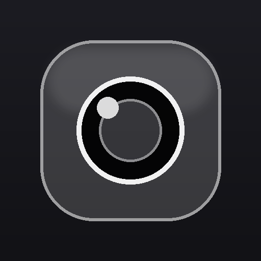
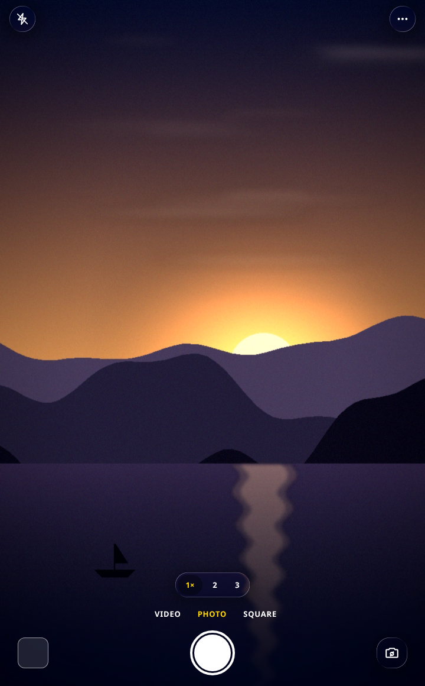
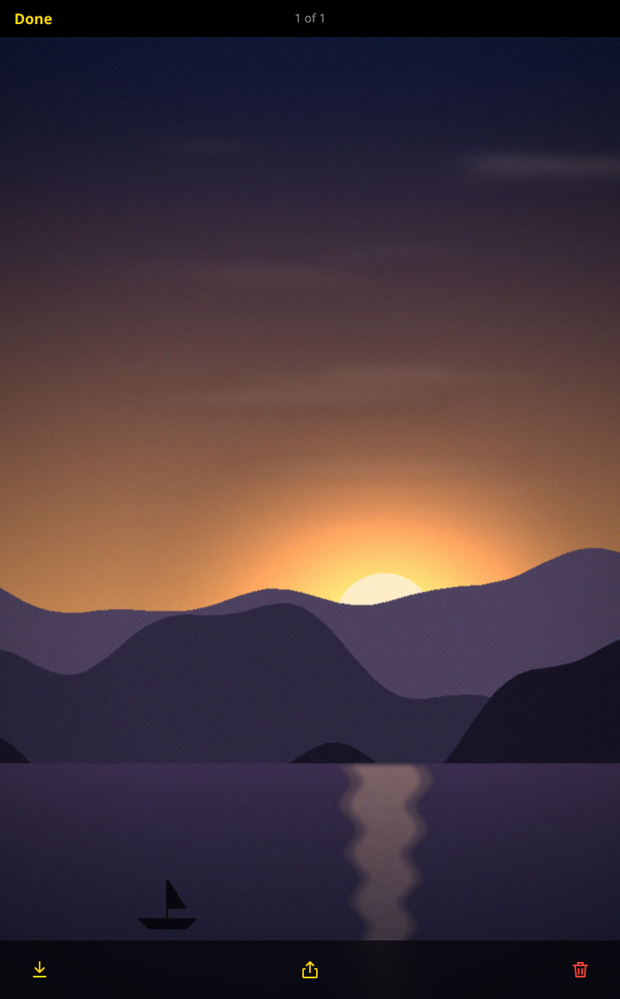
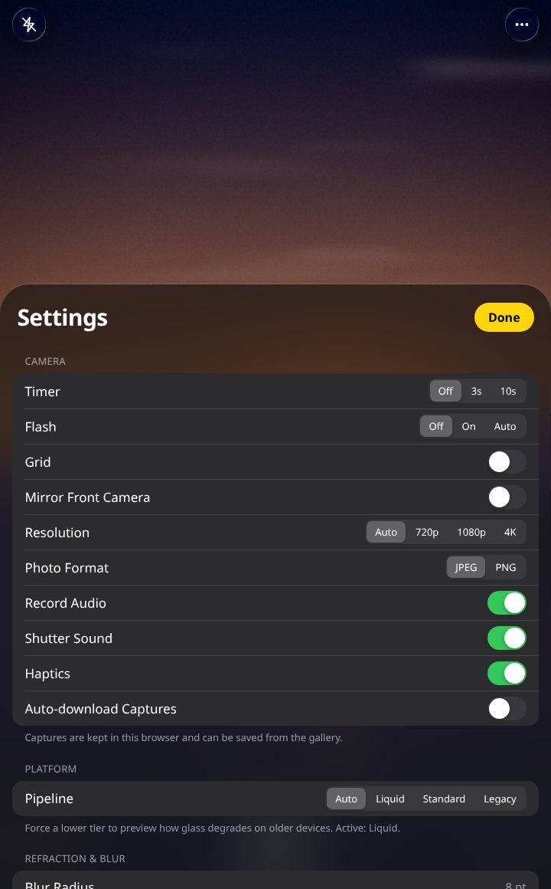

# Glass Camera

An iOS-style camera app with real liquid-glass UI, packaged as an installable Android APK.

The whole interface is one HTML file with WebGL glass shaders; a small native Android shell gives it
camera permission, a fullscreen window and a working gallery.

<p align="center">
  
</p>

<p align="center">
  
  &nbsp;
  
  &nbsp;
  
</p>

## Install

1. Download [`GlassCamera.apk`](https://github.com/technicalnihilist-lgtm/glass-camera/releases/download/v1.0/GlassCamera.apk) from the [latest release](https://github.com/technicalnihilist-lgtm/glass-camera/releases/latest) and copy it to your phone.
2. Open the file. Allow **install unknown apps** for your browser or file manager if prompted.
3. Android may warn that the app is from an unknown developer — it is self-signed, not published on
   the Play Store, so that prompt is expected.

Requires Android 8.0 (API 26) or newer. The app asks for camera and microphone access on first launch.

## Features

- Photo, video and square capture modes, with 1s / 2s / 3s timers
- Front/rear switching, tap-to-focus, pinch zoom, torch control
- Liquid-glass UI: real refraction, blur, dispersion and specular highlights rendered with WebGL,
  with a graceful frosted-glass fallback for devices without WebGL
- Live exposure and filter controls, grid overlay, shutter sound and haptics
- In-app gallery with save, share (Android share sheet) and delete
- Captures are written to `Pictures/GlassCamera` and `Movies/GlassCamera`, so they show up in the
  phone's own gallery app
- Fully offline — no network calls are needed to run

## How the APK is built

There is no framework in here: it is a single `Activity` (about 350 lines of Java) plus your page as
an asset.

| Concern | How it is handled |
| --- | --- |
| Secure origin | The page is served from `https://glasscamera.local`, intercepted from `assets/` in `WebViewClient.shouldInterceptRequest`. WebView refuses `getUserMedia` on `file://`, so a real https origin is required. |
| Camera permission | Runtime `CAMERA` / `RECORD_AUDIO` request, then `WebChromeClient.onPermissionRequest` grants the page's capture request. |
| Saving files | The page's download path is bridged to native code over a `JavascriptInterface`, which writes through MediaStore (scoped storage on Android 10+, legacy path below it). |
| Sharing | Saved items are shared as `content://` URIs through the system share sheet. |
| Lifecycle | The camera is released when the app goes to the background and restarted on return. |

### Repo layout

```
GlassCamera.apk          signed, installable build
glass-camera.html        the app itself — one self-contained file
icon.png                 512x512 app icon
screenshots/             viewfinder, gallery and settings sheet
```

### Building from source

You need JDK 17 and Android SDK build-tools 34 + platform 34 (`aapt2`, `d8`, `zipalign`,
`apksigner`). The shell only uses the Android framework, so no Gradle and no dependencies are needed:

```
aapt2 compile --dir res -o build/res.zip
aapt2 link -o build/base.apk -I $ANDROID/platforms/android-34/android.jar \
  --manifest AndroidManifest.xml build/res.zip -A assets \
  --min-sdk-version 26 --target-sdk-version 34
javac -source 8 -target 8 -bootclasspath $ANDROID/platforms/android-34/android.jar \
  -d build/classes $(find src build/gen -name "*.java")
d8 --lib $ANDROID/platforms/android-34/android.jar --min-api 26 --output build/dex build/classes/**/*.class
# add classes.dex to the apk, zipalign, then apksigner sign with your own key
```

The page inside the APK is `glass-camera.html` plus a short script appended at the end that routes
saves and shares to the native bridge.

## Notes and limitations

- The APK is signed with a self-signed key, so updates must be installed over the same build — an
  app from a different signer cannot replace it.
- Video container depends on the device's WebView: recent builds record MP4, older ones fall back to
  WebM.
- The camera preview in the screenshots is a synthetic test frame, because this build was produced
  without a physical camera attached. Everything else in the screenshots is the real UI.
- The build was verified statically (resources, manifest, dex, signature); it has not been run on a
  physical device as part of this repo's automation.

## Credits

The liquid-glass rendering is a WebGL port of the AGSL shaders from **PrismalAGSL** by
[Styropyr0](https://github.com/Styropyr0) — rectangle refraction, dispersion, ambient/default
specular, gradient glass and the colour controls. UI typeface is Inter (Google Fonts), with a system
fallback when offline.
